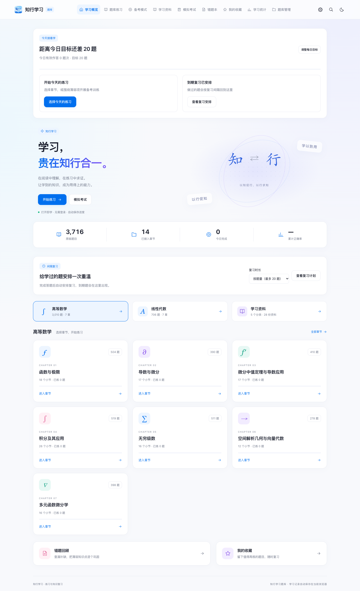

<div align="center">


# 知行学习

**行是知之始，知是行之成。**

章节练习 · 智能备考 · 间隔复习 · 学习资料

[进入网站](https://pilotmiku.github.io/KnowActAcademy/)

</div>

基于 NEUMathe 修改与适配的在线学习网站，提供高等数学、线性代数题库，以及习概、编程等学习资料。无需登录，学习记录自动保存在当前浏览器。

内置 **8,425 条题目记录，覆盖 17 章、182 个小节**。按题号统计，包含补充资料及未确认等价的相似题；部分转写仍待校对。[查看题量明细](docs/QUESTION_COUNTS.md)。



## 主要功能

- **练习与备考**：章节筛选、顺序或随机练习、薄弱项测评与加权训练；支持直接跳至题号、定位下一道待完成题，模拟考试可定位下一道未答题。
- **查题与纠错**：题目分页、公式摘要、完整题目预览、关键词高亮，以及个人纠错与核对记录。
- **复习与考试**：按错因筛选、选题组练、离线打印稿、章节配比组卷与可保存的考试模板。
- **复习日历**：设置考试日期、科目章节和每日时间，动态安排新题、薄弱题及到期复习；未完成任务重新分配，时间不足时提示未排入题量。
- **统一今日任务**：有复习计划时，首页采用日历的题量与时间安排；范围可细化到小节，并实时预览题量。
- **资料与笔记**：分类阅读、最近阅读接续、个人笔记，提供 17 个大章概览与覆盖全部 182 个小节的知识卡，可按科目、章节和关键词检索。
- **随题知识卡片**：当前小节的要点、公式、适用条件、例题和易错提醒在做题侧栏优先显示，切题自动跟随；支持独立查看、相邻小节切换和进入对应练习。已有逐题知识点卡片继续保留。
- **解题辅助**：知识卡片支持桌面侧栏和手机面板，重点题可逐层展开提示；题干、选项和解析中的图片可独立放大查看，支持 50%–300% 缩放。A–D 选答案、Enter 确认、方向键切题，输入笔记时暂停快捷键。手机在题目区域左滑下一题、右滑上一题，长公式仍可横向滚动。
- **补充解析**：为原资料缺解析题另写 55 道完整解析、2 道疑题核对推导和 1 道现存题干的部分解析，标明“本站整理”；另有 2 道原题缺损无法可靠补全，质量页可分别筛选。
- **学习反馈**：分别展示题库覆盖率、每题最近作答正确率与隔日巩固题量，提供薄弱小节练习入口。
- **学习体验**：新手引导、手机适配、深浅主题、字号调整与专注模式。
- **交互反馈**：连续切题保留导航与进度条，题干、选项和当前题号提供短暂反馈，慢加载显示占位提示；显示设置支持减少动态效果。
- **离线章节**：在页脚“离线题库”选择下载大章或小节，包含正文与公式图片，支持下载校验、版本更新和单独移除；离线资源与学习记录分别保存。

## 本地运行

推荐使用与 CI 一致的 Python 3.12、Node.js 22：

```sh
python3 -m venv .venv
source .venv/bin/activate
python -m pip install -r requirements.txt
npm ci
npx playwright install chromium webkit
npm run build
npm run dev
```

打开 `http://127.0.0.1:4188`。普通构建无需 OCR 模型或历史数学原件。

## 验证

```sh
npm run check:bank
npm test
npm run test:python
npm run build
npm run verify
npm run test:browser
```

测试报告和截图保存在 `artifacts/`，不提交仓库。PR 执行检查，主分支通过后自动部署到 GitHub Pages。

## 数据与备份

“数据备份”入口支持完整备份、轻量进度备份和可选的自建服务器同步，并记录上次发起导出的时间。轻量备份需配合同版本内置题库；换设备或清理浏览器前，请先导出备份。

纠错、个人学习标注、组卷模板和最近阅读记录均包含在学习数据中。个人核对不会改变原题答案或评分资格。内置题库当前均为单选题；引擎另外支持导入多选、判断、填空与解答题。内置题库均提供 1～5 星难度建议，支持按星级筛选和个人调整；优先采用个人标注，其次为 22 题编辑标注，其余按小节知识点、题干条件与可识别解题要点自动初评。初评未经实测校准，图片大小和原题默认难度不参与评级。未知来源题仍显示“待标注”；精确知识卡片共 14 张。

缺损或答案未核实的题目保留供查阅，不计评分、掌握度及复习计划。

已对全部 8,425 题执行题干、选项、来源答案和一致性扫描：恢复 8 道题的缺失题干，纠正 20 道解析的旧选项字母，新增标记 24 道有评分问题的原题；当前共 45 道仅供查阅、8,380 道可评分。扫描不表示全部题目已经独立求解正确，逐题证据和未复算状态见[题库扫描报告](docs/QUESTION_AUDIT.md)。

补充 HTML 题的文字与公式默认至少使用 18px，长原图可横向滚动，公式图片去除彩色边缘；72 个按原图核对的公式与符号另以数学排版呈现，覆盖 269 题中的 446 处使用。其余图片保留原图，放大不能恢复源文件中已经缺失的细节。收藏按钮以空心 / 实心星与文字表示状态，新增收藏播放短动画，并遵循减少动态效果设置。

难度初评由 `python3 scripts/question_difficulty.py` 生成。清晰公式校对记录位于 `data/readable-formulas.json`，修改后运行 `python3 scripts/readable_formulas.py`。静态构建校验两份生成文件，原题库与答案独立保留。

## 项目文档

- [开发与实现记录](docs/REVIEW.md)
- [同步后端部署](backend/README.md)
- [题库转写与原件恢复](docs/题库转写说明.md) · [原件归档登记](data/archived-math-sources.json)
- [Markdown 题库](question-bank-markdown/) · [逐题 Markdown 下载](question-bank-markdown/逐题Markdown.zip)
