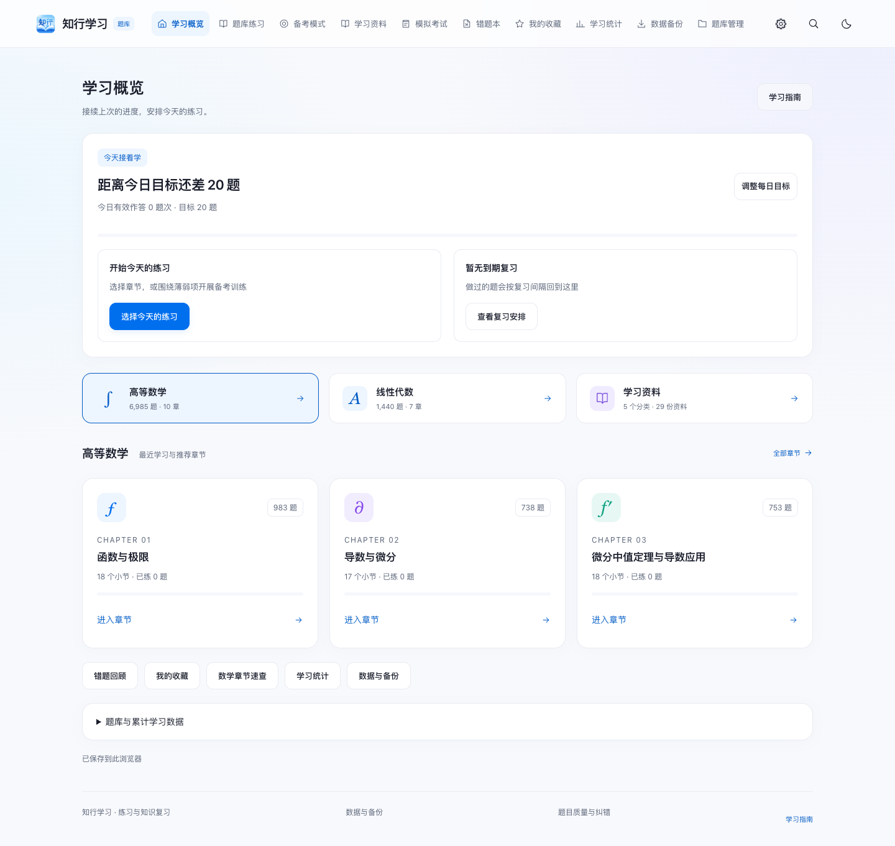

<div align="center">


# 知行学习

**行是知之始，知是行之成。**

章节练习 · 智能备考 · 间隔复习 · 学习资料

[进入网站](https://pilotmiku.github.io/KnowActAcademy/)

</div>

基于 NEUMathe 修改与适配的在线学习网站，提供高等数学、线性代数题库，以及习概、编程等学习资料。无需登录，学习记录自动保存在当前浏览器。

内置 **8,425 条题目记录，覆盖 17 章、182 个小节**。按题号统计，包含补充资料及未确认等价的相似题；部分转写仍待校对。[查看题量明细](docs/QUESTION_COUNTS.md)。



## 主要功能

- **练习与备考**：章节筛选、顺序或随机练习、薄弱项测评与加权训练。
- **查题与纠错**：题目分页、公式摘要、完整题目预览、关键词高亮，以及个人纠错与核对记录。
- **复习与考试**：按错因筛选、选题组练、离线打印稿、章节配比组卷与可保存的考试模板。
- **资料与笔记**：分类阅读、最近阅读接续、个人笔记，以及覆盖 17 个大章的数学速查卡片。
- **学习反馈**：分别展示题库覆盖率、每题最近作答正确率与隔日巩固题量，提供薄弱小节练习入口。
- **学习体验**：新手引导、手机适配、深浅主题、字号调整与专注模式。

## 本地运行

推荐使用与 CI 一致的 Python 3.12、Node.js 22：

```sh
python3 -m venv .venv
source .venv/bin/activate
python -m pip install -r requirements.txt
npm ci
npx playwright install chromium
npm run build
npm run dev
```

打开 `http://127.0.0.1:4188`。普通构建无需 OCR 模型或历史数学原件。

## 验证

```sh
npm run check:bank
npm test
npm run test:python
npm run build
npm run verify
npm run test:browser
```

测试报告和截图保存在 `artifacts/`，不提交仓库。PR 执行检查，主分支通过后自动部署到 GitHub Pages。

## 数据与备份

“数据备份”入口支持完整备份、轻量进度备份和可选的自建服务器同步，并记录上次发起导出的时间。轻量备份需配合同版本内置题库；换设备或清理浏览器前，请先导出备份。

纠错、个人学习标注、组卷模板和最近阅读记录均包含在学习数据中。个人核对不会改变原题答案或评分资格。内置题库当前均为单选题；引擎另外支持导入多选、判断、填空与解答题。难度采用个人或编辑标注，未标注题目明确显示“待标注”；首批编辑标注为 9 题。

缺损或答案未核实的题目保留供查阅，不计评分、掌握度及复习计划。

## 项目文档

- [开发与实现记录](docs/REVIEW.md)
- [同步后端部署](backend/README.md)
- [题库转写与原件恢复](docs/题库转写说明.md) · [原件归档登记](data/archived-math-sources.json)
- [Markdown 题库](question-bank-markdown/) · [逐题 Markdown 下载](question-bank-markdown/逐题Markdown.zip)
